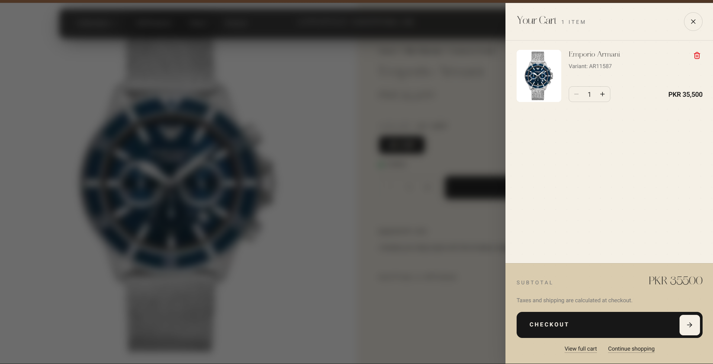
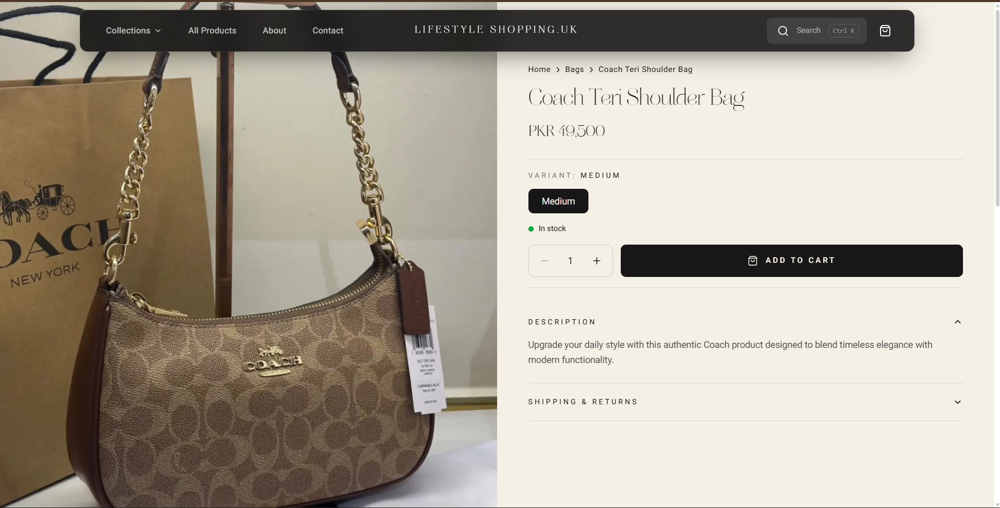
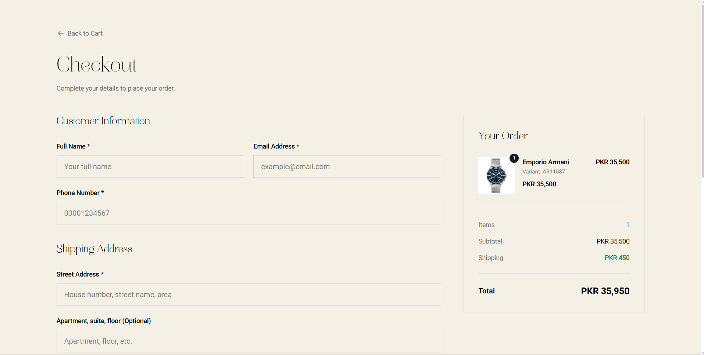
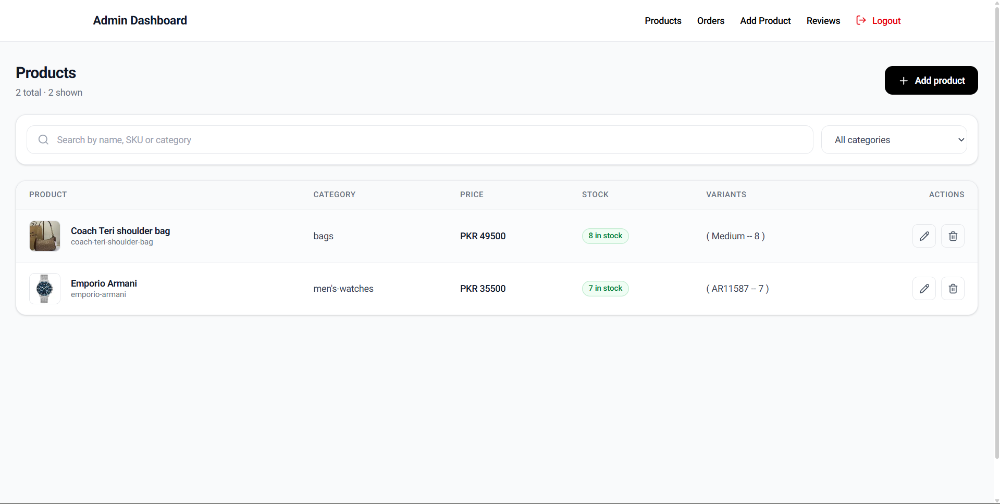
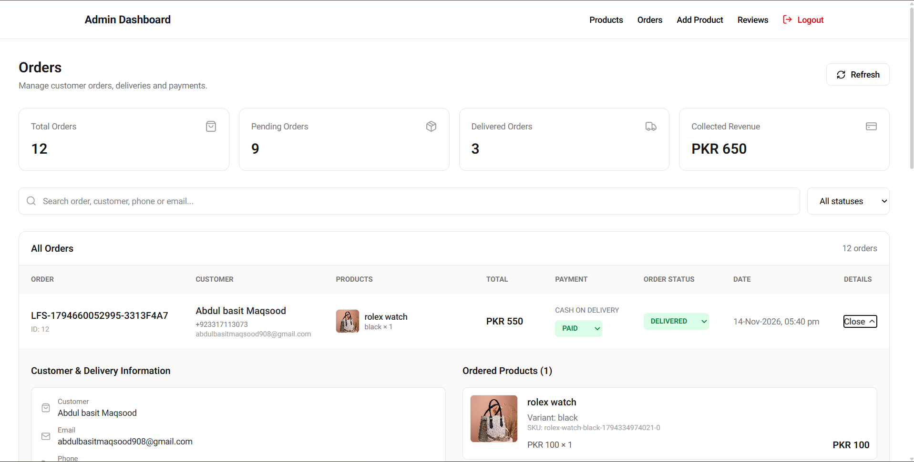
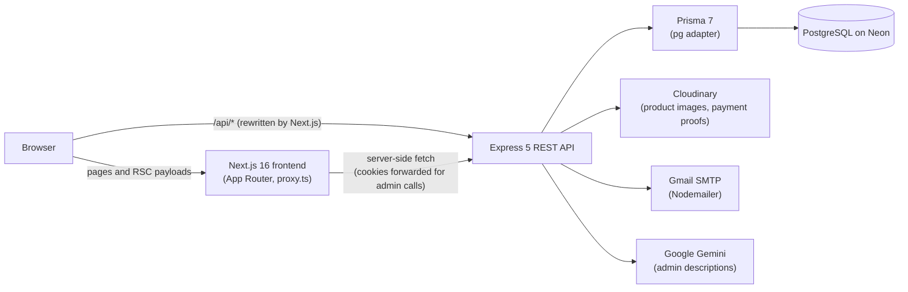
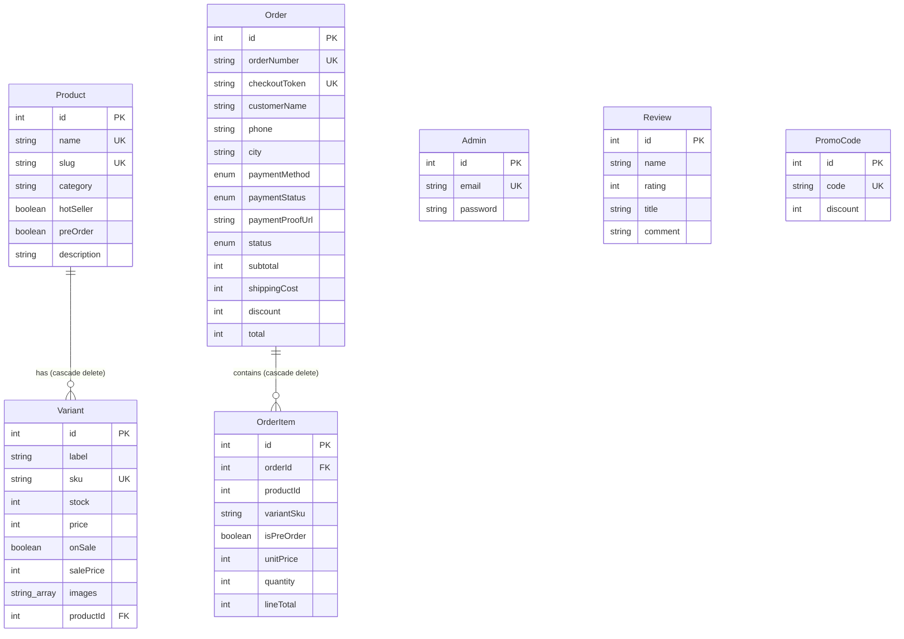
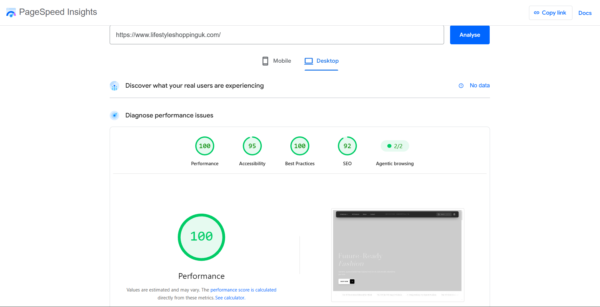
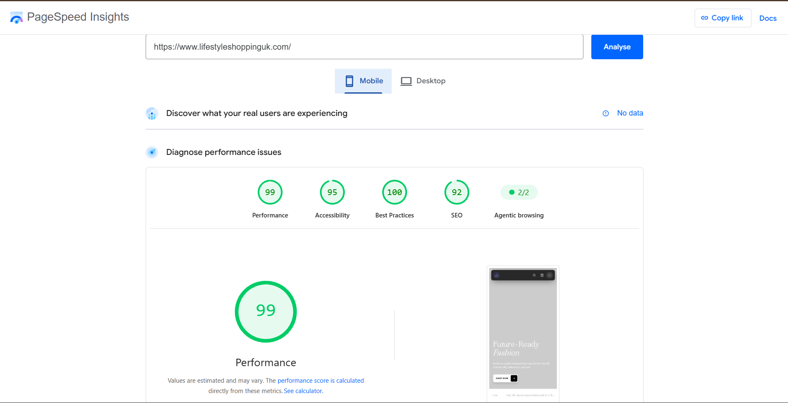

# Lifestyle Shopping UK

A full-stack e-commerce platform built for a Pakistan-based business that sells original imported fashion and lifestyle products sourced from the UK, USA, and UAE.

[](https://www.lifestyleshoppinguk.com/)
[](https://nextjs.org/)
[](https://react.dev/)
[](https://www.typescriptlang.org/)
[](https://expressjs.com/)
[](https://neon.tech/)
[](https://www.prisma.io/)
[](https://tailwindcss.com/)

**Live website:** [https://www.lifestyleshoppinguk.com/](https://www.lifestyleshoppinguk.com/)
**Repository:** [https://github.com/mussadiqkhan6886/lifestyle](https://github.com/mussadiqkhan6886/lifestyle)
**Developer:** [Mussadiq Khan](https://github.com/mussadiqkhan6886)

The storefront is a Next.js (App Router) application. It talks to a separate Express 5 REST API backed by PostgreSQL on Neon through Prisma. Product images and bank-transfer payment proofs are stored on Cloudinary, order and contact emails are sent through Nodemailer, and an admin dashboard secured by JWT and `httpOnly` cookies manages products, orders, promo codes, and reviews.

---

## Table of Contents

- [Project Overview](#project-overview)
- [Application Screenshots](#application-screenshots)
- [Key Features](#key-features)
- [Technology Stack](#technology-stack)
- [System Architecture](#system-architecture)
- [Project Structure](#project-structure)
- [Getting Started](#getting-started)
- [Environment Variables](#environment-variables)
- [API Documentation](#api-documentation)
- [Database Design](#database-design)
- [Authentication and Security](#authentication-and-security)
- [Performance and SEO](#performance-and-seo)
- [External Integrations](#external-integrations)
- [Deployment and Production](#deployment-and-production)
- [Engineering Challenges and Technical Decisions](#engineering-challenges-and-technical-decisions)
- [Future Improvements](#future-improvements)
- [Developer](#developer)

---

## Project Overview

Lifestyle Shopping UK is a Pakistan-based e-commerce business. It sources original products from the United Kingdom, United States, and United Arab Emirates and sells them to customers in Pakistan. "UK" is part of the brand name; the business itself operates from Pakistan.

**Product categories**

- Men's Watches
- Women's Watches
- Men's Clothing
- Women's Clothing
- Bags
- Men's Accessories (wallets and belts)
- Women's Wallets
- Women's Footwear

**Core workflows**

- Customers browse collections, search products, pick a product variant, add it to a cart, optionally apply a promo code, and check out as a guest with **Cash on Delivery** or **Bank Transfer** (with a payment screenshot).
- The store owner receives an email for each new order, and the customer receives a confirmation email if they provided an address. Products, orders, payment verification, promo codes, and reviews are managed from a protected admin area.
- Prices are stored in whole Pakistani rupees (PKR). Delivery is a flat fee based on the delivery city.
- Cash on Delivery is unavailable for orders above PKR 30,000, so those must be paid by bank transfer.
- Products can be flagged as **pre-order** by the admin.

**Engineering scope**

The project covers a decoupled Next.js and Express architecture, a relational data model with product variants and order snapshots, cookie-based JWT authentication with silent token refresh, transactional and idempotent checkout with stock protection, server-side promo and pricing calculation, payment-proof upload to Cloudinary, dynamic SEO metadata, and an AI-assisted product description generator for admins using the Google Gemini API.

---

## Application Screenshots

| HOMEPAGE | CART |
| --- | --- |
| [](./frontend/public/homepage.png) | [](./frontend/public/cart.png) |
| **PRODUCT** | **CHECKOUT** |
| [](./frontend/public/product.png) | [](./frontend/public/checkout.png) |
| **ADMIN PRODUCTS** | **ADMIN ORDERS** |
| [](./frontend/public/admin-products.png) | [](./frontend/public/admin-order.png) |

---

## Key Features

### Shopping Experience

- Home page with a video hero, category tiles, best sellers, new arrivals, a "why us" section, and customer reviews. Data-driven sections are wrapped in Suspense boundaries.
- Collection pages for each category plus an "All Products" view, with breadcrumbs.
- Product detail pages with an image gallery and recommended products from the same category.
- Responsive layout built with Tailwind CSS, with skeleton loaders for collection, search, and product views.

### Product Discovery

- Server-side search across product name, category, description, and slug (case-insensitive), with a debounce hook on the client.
- Sorting by featured, hot sellers, price, and name.
- "Load more" pagination using TanStack Query infinite queries. The API returns a `hasMore` flag and caps page size at 48.
- Dedicated endpoints for hot sellers and for new arrivals (products created in the last 7 days).

### Product Management

- Product create, update, and delete from the admin dashboard.
- Each product has one or more variants with their own label, SKU, stock, price, optional sale price, and images.
- Products can be marked as **hot sellers** or **pre-order**.
- Multiple image upload per variant. Images are compressed in the browser (max 1 MB, 1600 px) before upload, then stored on Cloudinary.
- AI-assisted description generation with Google Gemini (admin only).

### Cart and Checkout

- Cart state lives in a React Context and is persisted to `localStorage`, with stock-aware quantity limits.
- Guest checkout with React Hook Form and Zod, including Pakistani mobile number validation (normalized to `+92…`).
- The client sends only SKUs and quantities. The server recalculates prices, promo discount, shipping, and verifies stock.
- **Payment methods:** Cash on Delivery or Bank Transfer. Bank transfer requires a payment screenshot (JPG, PNG, or WEBP, up to 5 MB), which is uploaded to Cloudinary. COD orders must not include a screenshot.
- **COD limit:** orders with a total above PKR 30,000 cannot use Cash on Delivery (enforced on both client and server).
- **Delivery fee:** PKR 400 for Lahore and PKR 450 for other cities.
- Order confirmation page and email notifications.

### Promo Codes

- Admins create, edit, and delete percentage-based promo codes (1 to 100 percent) from the admin Promos page. Codes are stored in upper case.
- Customers apply a code at checkout; it is checked through `POST /api/promos/verify`.
- The discount applies to the **subtotal** (not shipping) and is recalculated on the server when the order is placed, so the client cannot tamper with it.

### Pre-orders

- A product flagged as pre-order carries that flag onto each order item (`OrderItem.isPreOrder`), so the store can tell pre-order lines apart when processing an order.

### Authentication and Authorization

- Admin-only authentication (there are no customer accounts).
- Access and refresh tokens stored in `httpOnly` cookies.
- Admin pages are protected in Next.js `proxy.ts`, and admin API routes are protected by JWT middleware.

### Customer Management

- Customers check out as guests; their details are stored on each order (name, phone, optional email, address).
- A contact form sends messages to the store's inbox via email, with an optional order number reference.
- Customers can submit product reviews without an account.

### Order Management

- Order list with search (order number, name, phone, email) and status filter.
- Order status workflow: `PENDING`, `CONFIRMED`, `PROCESSING`, `SHIPPED`, `DELIVERED`, `CANCELLED`.
- Payment status workflow: `UNPAID`, `PENDING_VERIFICATION`, `PAID`, `REJECTED`. Bank-transfer orders start as `PENDING_VERIFICATION`; COD orders start as `UNPAID`.
- Expandable order details showing the item snapshot, shipping information, and the payment proof for bank transfers.

### Admin Dashboard

- Dashboard home with navigation cards.
- Product list with search, category filter, stock badges (out of stock / low stock), and delete confirmation.
- Order summary cards: total orders, pending orders, delivered orders, and collected revenue (sum of paid orders).
- Promo code management and review moderation (delete).

### Performance and SEO

- Dynamic `generateMetadata` for collection and product pages, with canonical URLs and Open Graph / Twitter tags.
- `sitemap.ts` generated from the product catalogue, and a `robots.txt` that excludes admin, checkout, cart, and search pages.
- `generateStaticParams` for collection and product routes.
- Public API reads use a 60-second revalidation window; TanStack Query uses a 60-second stale time.
- `next/image` configured for Cloudinary-hosted images.

### Security and Validation

- Zod validation on both the frontend and the API.
- Helmet, rate limiting, cookie flags, upload restrictions, and production-safe error responses. See [Authentication and Security](#authentication-and-security).

---

## Technology Stack

| Category | Technologies |
| --- | --- |
| Frontend | Next.js 16.4.5 (App Router), React 19.3.0, TypeScript 5 |
| Styling and UI | Tailwind CSS 4, Lucide React, Swiper (product carousel), Sonner (toasts) |
| Data Fetching | TanStack React Query 5 |
| Forms and Validation | React Hook Form, `@hookform/resolvers`, Zod 4 |
| Backend | Node.js, Express 5, TypeScript |
| Database | PostgreSQL on Neon |
| ORM | Prisma 7 with the `@prisma/adapter-pg` driver adapter |
| Authentication | JSON Web Tokens (`jsonwebtoken` on the API, `jose` in the Next.js proxy), bcryptjs, cookie-parser |
| Security Middleware | Helmet, CORS, express-rate-limit |
| File Storage | Cloudinary, Multer (memory storage) |
| Email | Nodemailer (Gmail SMTP service) |
| AI | Google GenAI SDK (Gemini) |
| Client Utilities | browser-image-compression |
| Tooling | ESLint 9 (`eslint-config-next`), tsx, Prisma CLI |

---

## System Architecture



**Why the frontend and backend are separate.** The storefront and the API are independent applications with their own `package.json`, build, and environment. The API can be changed, redeployed, or reused (for example by a mobile app) without touching the UI, and the Next.js app focuses on rendering, SEO, and routing.

**API communication.** There are two paths to the API:

1. Server-side helpers in `frontend/lib/helpers` (`fetchHelper` and `fetchHelperNoCookies`) call `${NEXT_PUBLIC_BASE_URL}/api/...`. Public catalogue reads use a 60-second revalidation window. Admin calls forward the browser's cookies to the API.
2. Browser-side calls such as login, logout, and promo verification go to `/api/*`. `next.config.ts` rewrites `/api/:path*` to the deployed API, so authentication cookies are issued through the frontend's own origin.

**Authentication.** The API issues a short-lived access token (15 minutes) and a refresh token (7 days) as `httpOnly` cookies. `frontend/proxy.ts` runs on `/admin/*` and `/login`, verifies the access token with `jose`, and calls `/api/auth/refresh` when the access token is missing or expired, forwarding the new `Set-Cookie` headers. The API also verifies the access token on every protected route.

**Database operations.** Controllers call Prisma directly. Multi-step writes (checkout, product create/update) run inside `prisma.$transaction`. The Prisma client is created once with the `pg` adapter and cached on `globalThis` outside production.

**External integrations.** Cloudinary receives product images and payment proofs from the API via upload streams. Nodemailer sends order and contact emails. Gemini is called only from the admin-only AI endpoint.

---

## Project Structure

```
lifestyle/
├── backend/
│   ├── prisma/
│   │   ├── schema.prisma            # Data model
│   │   └── migrations/              # init, add_review_model, add_checkout_model,
│   │                                # add_online_payment_and_preorder, added_promo
│   ├── generated/prisma/            # Generated Prisma client (committed)
│   ├── src/
│   │   ├── server.ts                # Entry point (listens on PORT, default 4000)
│   │   ├── app.ts                   # Middleware stack and route mounting
│   │   ├── config/                  # prisma, cloudinary, nodemailer, geminiAI, CORS
│   │   ├── routes/                  # auth, products, orders, review, contact, promos, ai
│   │   ├── controllers/             # Request handlers and business logic
│   │   ├── middleware/              # verifyJWT, rate limiters, upload, ErrorHandler
│   │   ├── schemas/                 # Zod request schemas
│   │   ├── service/                 # Gemini service
│   │   ├── lib/helpers/             # slugs, order numbers, variants, Cloudinary upload, email templates
│   │   └── types/                   # Express and shared type declarations
│   ├── neon.ts                      # Neon project config
│   ├── prisma7.config.ts            # Prisma CLI config (datasource, migrations path)
│   ├── nodemon.json
│   └── tsconfig.json
│
└── frontend/
    ├── app/
    │   ├── (client)/                # Storefront: home, collections, product, cart, search, about, contact, policies, add-review
    │   ├── (checkout)/              # checkout and order-success
    │   ├── (admin)/admin/           # Dashboard, products, add-product, orders, promos, reviews
    │   ├── (login)/login/           # Admin login
    │   ├── sitemap.ts
    │   └── layout.tsx               # Root layout (React Query, Cart, Toaster providers)
    ├── components/                  # admin/, client/, providers/, ui/
    ├── sections/                    # Home page sections
    ├── context/CartContext.tsx      # Cart state with localStorage persistence
    ├── hooks/                       # useCart, useDebounce, useHasMounted
    ├── server/                      # API client functions (product, order, review, auth, contact, promo, ai)
    ├── lib/                         # constants, fonts, Zod schemas, fetch helpers
    ├── proxy.ts                     # Admin route protection and token refresh
    ├── next.config.ts
    └── public/                      # Images, fonts, videos, robots.txt
```

---

## Getting Started

### Prerequisites

- Node.js compatible with Next.js 16 (no `engines` field is declared in either `package.json`)
- npm
- A PostgreSQL database (the project uses [Neon](https://neon.tech/))
- Optional, depending on the features you want to run: a Cloudinary account (product images and payment proofs), a Gmail account with an app password (order and contact emails), a Google AI API key (AI descriptions)

### Clone the repository

```bash
git clone https://github.com/mussadiqkhan6886/lifestyle.git
cd lifestyle
```

### Install dependencies

```bash
cd backend && npm install
cd ../frontend && npm install
```

### Configure environment variables

Create `backend/.env` and `frontend/.env` using the tables in [Environment Variables](#environment-variables). Both files are git-ignored.

### Set up the database

The Prisma CLI configuration file is named `prisma7.config.ts`, so pass it explicitly:

```bash
cd backend
npx prisma migrate deploy --config prisma7.config.ts
```

The generated Prisma client is committed under `backend/generated/prisma`. To regenerate it after a schema change, run `npx prisma generate --config prisma7.config.ts`.

**Create an admin account.** There is no registration endpoint; admin users are inserted directly into the `Admin` table with a bcrypt-hashed password:

```bash
cd backend
node -e "console.log(require('bcryptjs').hashSync('YOUR_PASSWORD', 10))"
```

```sql
INSERT INTO "Admin" (email, password) VALUES ('admin@example.com', '<hash from above>');
```

### Run the development servers

```bash
# Terminal 1: API (default http://localhost:4000)
cd backend
npm run dev

# Terminal 2: storefront (http://localhost:3000)
cd frontend
npm run dev
```

### Production build

```bash
# API
cd backend
npm run build      # tsc -> dist/
npm start          # node dist/src/server.js

# Storefront
cd frontend
npm run build
npm start
```

---

## Environment Variables

Values below are placeholders. Never commit real secrets.

### Backend (`backend/.env`)

| Variable | Description | Required |
| --- | --- | --- |
| `DATABASE_URL` | PostgreSQL connection string (Neon). Used by the Prisma adapter and the Prisma CLI. | Yes |
| `ACCESS_TOKEN` | Secret used to sign and verify access JWTs. | Yes |
| `REFRESH_TOKEN` | Secret used to sign and verify refresh JWTs. | Yes |
| `FRONTEND_URL` | Frontend origin, added to the CORS allow-list. | Recommended |
| `PORT` | API port. Defaults to `4000`. | No |
| `NODE_ENV` | `production` enables secure cookies and hides internal error messages. | No |
| `CLOUDINARY_CLOUD_NAME` | Cloudinary cloud name. | For image and payment-proof uploads |
| `CLOUDINARY_API_KEY` | Cloudinary API key. | For image and payment-proof uploads |
| `CLOUDINARY_API_SECRET` | Cloudinary API secret. | For image and payment-proof uploads |
| `EMAIL_USER` | Gmail address used to send emails and to receive order and contact notifications. | For emails |
| `EMAIL_APP_PASSWORD` | Gmail app password. | For emails |
| `STORE_NAME` | Store name used in email templates. Falls back to "Lifestyle Store". | No |
| `GEMINI_AI_API_KEY` | Google AI API key for description generation. | For AI feature |

All backend variables are server-side secrets.

### Frontend (`frontend/.env`)

| Variable | Description | Required |
| --- | --- | --- |
| `NEXT_PUBLIC_BASE_URL` | Base URL of the API (for example `http://localhost:4000`), without a trailing slash. Used by the server-side fetch helpers and `proxy.ts`. | Yes |
| `ACCESS_TOKEN` | Same secret as the backend `ACCESS_TOKEN`. Used by `proxy.ts` to verify access tokens. Server-side only. | Yes |

`NEXT_PUBLIC_*` variables are exposed to the browser bundle, so only non-secret values belong there. `ACCESS_TOKEN` has no `NEXT_PUBLIC_` prefix and stays on the server.

---

## API Documentation

Routes are mounted under `/api/*` (the same routers are also mounted without the `/api` prefix). Rate limiters: **login** 10 requests / 15 min, **API** 100 requests / 5 min, **AI** 3 requests / 1 min.

### Health

| Method | Endpoint | Description | Authentication |
| --- | --- | --- | --- |
| GET | `/api/health` | Health check, returns `ok` | None |

### Authentication

| Method | Endpoint | Description | Authentication |
| --- | --- | --- | --- |
| POST | `/api/auth/login` | Admin login; sets access and refresh cookies (login rate limiter) | None |
| POST | `/api/auth/logout` | Clears auth cookies | Cookie |
| POST | `/api/auth/refresh` | Issues a new access token from the refresh cookie | Refresh cookie |

### Products

| Method | Endpoint | Description | Authentication |
| --- | --- | --- | --- |
| GET | `/api/products` | List products. Query: `q`, `category`, `sort` (`featured`, `hot-sellers`, `price-asc`, `price-desc`, `name`), `page`, `limit` (max 48) | None |
| GET | `/api/products/hot-sellers` | Products flagged as hot sellers | None |
| GET | `/api/products/new-arrivals` | Products created in the last 7 days | None |
| GET | `/api/products/:slug` | Single product with variants | None |
| POST | `/api/products` | Create product with variants and images (multipart) | Admin |
| PATCH | `/api/products/:id` | Update product, variants, and images (multipart) | Admin |
| DELETE | `/api/products/:id` | Delete product (variants cascade) | Admin |

### Orders

| Method | Endpoint | Description | Authentication |
| --- | --- | --- | --- |
| POST | `/api/orders` | Place an order (guest checkout, idempotent via `checkoutToken`). Multipart: a `data` field containing the order JSON, plus a `paymentProof` image file for bank transfers | None |
| GET | `/api/orders` | List all orders with items | Admin |
| GET | `/api/orders/:id` | Fetch an order by its order number | None (rate limited) |
| PATCH | `/api/orders/:id` | Update `status` and/or `paymentStatus` | Admin |

### Promo Codes

| Method | Endpoint | Description | Authentication |
| --- | --- | --- | --- |
| POST | `/api/promos/verify` | Check a promo code and return its discount percentage | None |
| GET | `/api/promos` | List all promo codes | Admin |
| GET | `/api/promos/:id` | Fetch one promo code | Admin |
| POST | `/api/promos` | Create a promo code (`code`, `discount` 1 to 100) | Admin |
| PATCH | `/api/promos/:id` | Update a promo code | Admin |
| DELETE | `/api/promos/:id` | Delete a promo code | Admin |

### Reviews

| Method | Endpoint | Description | Authentication |
| --- | --- | --- | --- |
| GET | `/api/review` | List reviews, newest first | None |
| POST | `/api/review` | Submit a review | None |
| DELETE | `/api/review/:id` | Delete a review | Admin |

### Contact

| Method | Endpoint | Description | Authentication |
| --- | --- | --- | --- |
| POST | `/api/contact` | Send a contact message to the store inbox | None (rate limited) |

### AI

| Method | Endpoint | Description | Authentication |
| --- | --- | --- | --- |
| POST | `/api/ai/generate` | Generate or rewrite a product description from a name or draft | Admin (AI rate limited) |

No Swagger/OpenAPI documentation is implemented.

---

## Database Design

PostgreSQL schema managed with Prisma migrations (five migrations to date).



**Design decisions**

- **Variants as a separate table.** A product owns one or more variants, each with its own SKU, stock, pricing, sale price, and image list. The SKU is unique and is what the cart and checkout use to identify a purchasable item.
- **Order item snapshots.** `OrderItem` stores the product name, slug, SKU, variant label, image, pre-order flag, and unit price as they were at purchase time. `productId` is kept as a plain integer with no foreign key, so editing or deleting a product does not alter past orders.
- **Idempotent checkout.** `Order.checkoutToken` is unique and optional, so a retried checkout request resolves to the existing order.
- **Standalone promo codes.** `PromoCode` is a simple lookup table. An order records the resulting `discount` amount, not a reference to the code, so deleting a code never changes past orders.
- **Indexes.** `Order` is indexed on `phone`, `(status, createdAt)`, `createdAt`, and `(paymentStatus, createdAt)`. `OrderItem` is indexed on `orderId` and `variantSku`. Unique indexes cover `Admin.email`, `Product.name`, `Product.slug`, `Variant.sku`, `PromoCode.code`, `Order.orderNumber`, and `Order.checkoutToken`.
- **Enums.** `OrderStatus` (`PENDING`, `CONFIRMED`, `PROCESSING`, `SHIPPED`, `DELIVERED`, `CANCELLED`), `PaymentStatus` (`UNPAID`, `PAID`, `PENDING_VERIFICATION`, `REJECTED`), and `PaymentMethod` (`CASH_ON_DELIVERY`, `BANK_TRANSFER`) are database enums.
- **Money as integers.** Prices, totals, discounts, and delivery fees are stored as whole PKR integers, avoiding floating-point rounding.

---

## Authentication and Security

| Mechanism | Implementation |
| --- | --- |
| JWT access + refresh tokens | Access token valid for 15 minutes, refresh token for 7 days, signed with separate secrets. |
| Cookie-based sessions | Tokens are stored in `httpOnly` cookies with `sameSite: lax` and `secure` enabled when `NODE_ENV=production`. |
| Password hashing | Passwords are verified with `bcryptjs`. |
| Protected routes | Frontend: `proxy.ts` guards `/admin/*` and redirects unauthenticated users to `/login`. Backend: `verifyJWT` guards admin endpoints. |
| Silent refresh | `proxy.ts` calls the refresh endpoint when the access token is missing or invalid and forwards the new cookies. |
| Access model | A single `Admin` table; there is no role hierarchy or customer login. |
| Input validation | Zod schemas validate login, products, orders, reviews, contact messages, and AI requests. The order schema is `.strict()` and normalizes Pakistani phone numbers to `+92…`. Promo input is validated in the controller (integer discount from 1 to 100). |
| Server-side pricing | Prices, promo discount, shipping, and the COD limit are all computed on the server. The client only sends SKUs, quantities, and an optional promo code. |
| Helmet | Adds standard security headers. |
| CORS | Configured with credentials enabled. See [Known Limitations](#known-limitations). |
| Rate limiting | Separate limiters for login, general API, and AI endpoints. |
| Upload controls | Multer with memory storage, image MIME types only, 5 MB per file, up to 20 files. |
| Request size limits | JSON bodies limited to 1 MB; URL-encoded bodies to 100 KB. |
| Error handling | A central error handler returns a generic message for 500 errors in production and includes stack traces only outside production. |
| Email safety | Order email templates escape user-provided values. |

These measures reduce common risks but do not make the application invulnerable. See [Known Limitations](#known-limitations) for known gaps.

---

## Performance and SEO

- **Rendering.** Built on the Next.js App Router with `cacheComponents` and `partialPrefetching` enabled in `next.config.ts`. Data-dependent sections (best sellers, new arrivals, product detail, collections) are wrapped in Suspense with skeleton fallbacks so the page shell renders first.
- **Static params.** `generateStaticParams` is defined for collection and product routes.
- **Caching.** Public API reads use `next: { revalidate: 60 }`. TanStack Query uses `staleTime: 60s` and disables refetch on window focus.
- **Pagination.** The products endpoint uses `take`/`skip` with a `limit + 1` lookahead to compute `hasMore`, and the UI loads additional pages on demand.
- **Images.** `next/image` with a Cloudinary `remotePatterns` rule. Admin uploads are compressed in the browser before they are sent.
- **Metadata.** `generateMetadata` on collection, product, and search pages, with canonical URLs and Open Graph / Twitter metadata. Admin, checkout, and order-success pages are marked `noindex`.
- **Sitemap and robots.** `app/sitemap.ts` builds entries for static pages, collections, and products by paging through the API. `public/robots.txt` disallows private routes and references the sitemap.
- **Search Console.** A Google site verification tag is set in the root layout.
- **Database.** Indexes on the order tables, and a single shared Prisma client.

| Desktop PageSpeed | Mobile PageSpeed |
| --- | --- |
| [](./frontend/public/desktop.png) | [](./frontend/public/mobile.png) |

---

## External Integrations

| Service | Purpose | How it is integrated |
| --- | --- | --- |
| **Neon (PostgreSQL)** | Primary database | Prisma with `@prisma/adapter-pg`, connection string from `DATABASE_URL`. `neon.ts` holds Neon project/branch configuration. |
| **Cloudinary** | Product image and payment-proof storage | Multer keeps files in memory; the API streams each image to Cloudinary and stores the returned `secure_url` on the variant (product images) or on the order (`paymentProofUrl`). If an order fails after a proof was uploaded, the uploaded file is deleted. |
| **Nodemailer (Gmail SMTP)** | Order and contact emails | On a new order, an admin notification is sent and, if the customer provided an email, a confirmation too. Email failures are logged and do not fail the order. Contact form messages are sent with `replyTo` set to the sender. |
| **Google Gemini** | Admin description writer | A rate-limited, JWT-protected endpoint sends a constrained prompt (plain text, 4 to 5 sentences, no invented features) and returns the text to the product form. |

---

## Deployment and Production

- **Live site:** [https://www.lifestyleshoppinguk.com/](https://www.lifestyleshoppinguk.com/)
- **Hosting:** the frontend and the API are deployed as two separate projects on Vercel.
- **Database:** Neon PostgreSQL.
- **Domain:** registered with GoDaddy, using Vercel's nameservers.
- **API build:** `npm run build` compiles TypeScript to `backend/dist`; `npm start` runs `node dist/src/server.js`.
- **Frontend build:** `npm run build` then `npm start` (`next build` / `next start`).
- **Configuration:** environment variables are supplied through `.env` locally and the hosting provider's settings in production.

---

## Engineering Challenges and Technical Decisions

### 1. Safe, repeatable checkout

**Problem:** Customers can double-click, retry on a flaky connection, or order the last item at the same time as someone else. Trusting prices from the browser would also be unsafe.

**Approach:** Treat the server as the source of truth and make the operation idempotent.

**Solution:** The client generates a UUID `checkoutToken` and sends only SKUs and quantities. The API merges duplicate SKUs, then inside a single `prisma.$transaction` loads the variants, calculates prices (sale price when active), applies the promo discount, computes shipping, enforces the COD limit, decrements stock with a conditional `updateMany` (`stock >= quantity`), and creates the order with its items. A repeated token returns the existing order, and a concurrent duplicate is handled by catching the unique-constraint error (`P2002`).

**Engineering value:** Prevents duplicate orders and overselling, and removes client-side price tampering as an attack surface.

### 2. Bank-transfer orders with payment proof

**Problem:** Online payments are made manually, so the store needs evidence of payment attached to the right order, without leaving orphaned files if checkout fails.

**Approach:** Accept the order and the screenshot in a single multipart request, and track verification as a separate payment status.

**Solution:** The order JSON travels in a `data` field next to a `paymentProof` image. The server rejects a bank transfer without a screenshot and a COD order with one, uploads the proof to Cloudinary, and stores its URL on the order with status `PENDING_VERIFICATION`. If anything fails afterwards, the uploaded file is deleted. The admin then marks the payment `PAID` or `REJECTED`.

**Engineering value:** Keeps the manual payment flow auditable and the file storage clean.

### 3. Product variants with image upload

**Problem:** One product form must create a product, several variants, and many images, with each image attached to the right variant, over a multipart request.

**Approach:** Normalize the input, validate it, upload, then persist atomically.

**Solution:** Helpers parse variants from several possible request shapes and map each uploaded file to a variant (by field name, index maps, or filename, with sensible fallbacks). Zod schemas coerce form strings to numbers/booleans and enforce rules such as "sale price must be lower than regular price". Files go to Cloudinary, and the product and its variants are written in one transaction. On the client, images are compressed before upload.

**Engineering value:** Keeps uploads small and fast, keeps catalogue data consistent, and tolerates different form encodings.

### 4. Authentication across two applications

**Problem:** Admin sessions must work between a Next.js frontend and a separate Express API, including server-side rendering and server-to-server calls.

**Approach:** Use `httpOnly` cookie tokens and handle refresh at the edge of the frontend.

**Solution:** The API issues access and refresh cookies. `proxy.ts` verifies the access token with `jose`, refreshes through the API when needed, and forwards the new `Set-Cookie` headers. Server-side fetch helpers forward the request's cookies on admin calls, and the `/api` rewrite lets login and logout run through the frontend's origin.

**Engineering value:** Tokens are never exposed to client JavaScript, and admins stay signed in without visible interruptions.

### 5. Order history that survives catalogue changes

**Problem:** Products get renamed, repriced, or deleted, but past orders must remain accurate.

**Approach:** Snapshot the data that matters at purchase time.

**Solution:** `OrderItem` copies product name, slug, SKU, variant label, image, pre-order flag, and unit price, and does not use a foreign key to `Product`.

**Engineering value:** Order records stay historically correct and product deletion never cascades into order data.

### 6. SEO for a dynamic catalogue

**Problem:** Product and collection pages are generated from database content that changes over time.

**Approach:** Derive metadata and the sitemap from the same API the pages use.

**Solution:** `generateMetadata` builds titles, descriptions, canonical URLs, and social images per product and collection. `sitemap.ts` pages through the API to include every product and category, and `robots.txt` keeps private routes out of search.

**Engineering value:** New products become discoverable without manual SEO work.

---

## Future Improvements

These are ideas, not current functionality.

- Automated testing with API integration tests and end-to-end checkout workflows, supported by CI pipelines for linting, type-checking, and production builds.
- Automated online payment gateway integration (for example Stripe or PayFast) to replace manual bank-transfer verification.
- Customer accounts with order history and order tracking.
- Redis caching to reduce database load and improve API response times.
- Admin user management with role-based access control (RBAC).
- Interactive API documentation using OpenAPI and Swagger.

---

## Developer

**Mussadiq Khan** Full-Stack Engineer

- GitHub: [https://github.com/mussadiqkhan6886](https://github.com/mussadiqkhan6886)
- Portfolio: [http://mussadiqkhan.vercel.app/](http://mussadiqkhan.vercel.app/)
- LinkedIn: [https://www.linkedin.com/in/mussadiq-khan-dev/](https://www.linkedin.com/in/mussadiq-khan-dev/)
